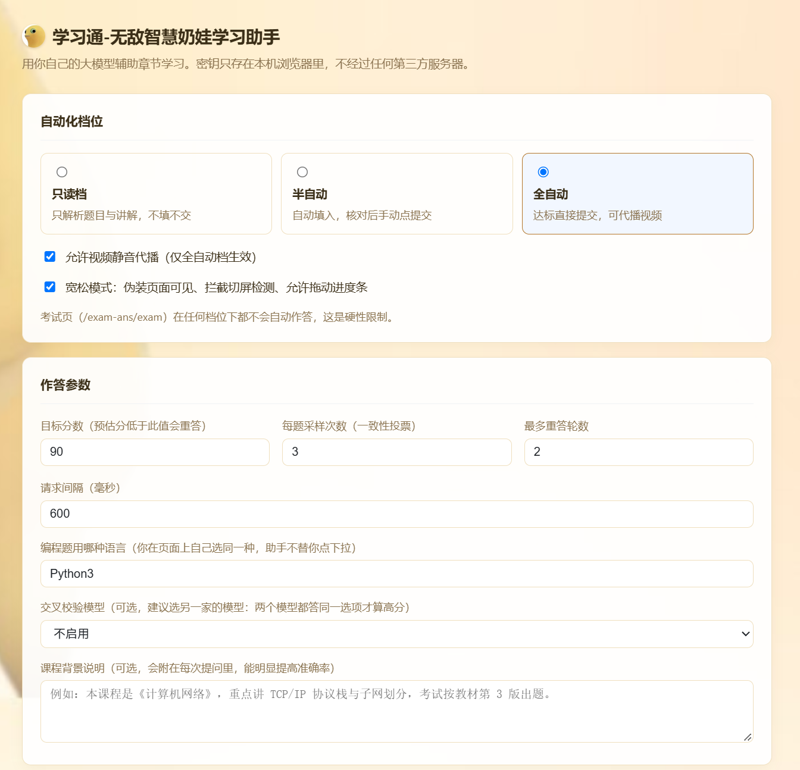
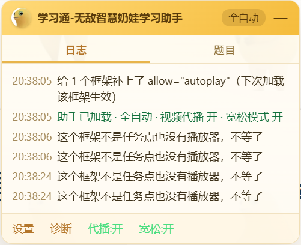
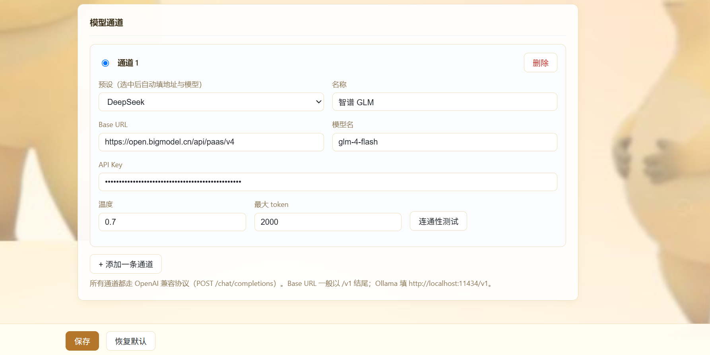

# 学习通-无敌智慧奶娃学习助手

> 用**你自己配置的大模型**辅助学习通（超星）章节学习：盘点任务点、播放视频、解析题目、作答、核对成绩。

版本 **0.4.9** · Manifest V3 · Chrome / Edge（Chromium 111 及以上）

---

## 免责声明（使用前务必读完）

**1. 用途限定。** 本项目仅供个人学习 JavaScript、浏览器扩展开发与自动化测试技术之用。请勿用于代替真实的课程学习，请勿用于任何考试场景，请勿用于违反你所在学校规章制度或中华人民共和国法律法规的用途。因使用本工具产生的任何后果，由使用者自行承担。

**2. 账号风险，请你自己评估。** 浏览器自动化会在平台服务端留下可被识别的操作特征——答题耗时、鼠标轨迹、播放上报时序、页面焦点变化等等。学习通有权据此判定违规，处置手段包括但不限于：清除学习记录、成绩作废、警告、纪律处分。**使用即表示你已知悉并接受这一风险。** 作者无法、也不会为你的账号做任何担保。

**3. 考试功能被刻意移除。** 本扩展在考试页（`/exam-ans/exam`）**不会**做任何自动作答，任何档位下都是如此。这不是能力不足，是硬性红线：考试页有摄像头随机抓拍人脸比对、`visibilitychange` 记录切屏、按题记录 `answerTime`，自动作答留下的日志特征极其明显。如果你想改代码打开这个口子，请自行承担后果，且不要声称是本项目的功能。

**4. 数据与隐私。** API Key 只保存在你本机的 `chrome.storage.local` 中，作者不收集、不上传、不中转任何数据。所有模型请求由扩展后台直接发往**你自己填写的**接口地址。但请注意：题目内容和你的作答会发送给该 API 的服务商，这属于你与服务商之间的约定，请自行评估其隐私政策。

**5. 无担保。** 本软件按「现状」（as-is）提供，不附带任何明示或暗示的担保，包括但不限于可用性、准确性、不中断、适用于特定目的。**大模型会答错题**，提交前请自行核对，尤其是全自动档。

**6. 与平台无关。** 本项目为独立实现，与超星学习通、知到智慧树等平台及其关联公司**没有任何关系**，未获其授权、认可或支持。项目名称中出现平台名仅为说明兼容对象。

**7. 第三方商标与内容。** 课程视频、题目、教材内容的版权归原权利人所有。本工具不存储、不分发任何课程内容。

**8. 版权与分发。** 仓库当前**未附带开源许可**。在完成代码原创性确认之前，请勿再分发、请勿商用、请勿二次打包发布。

**如果你不接受上述任何一条，请立即停止使用并删除本扩展。**

---

## 一、它能做什么

| 能力 | 说明 |
| --- | --- |
| 任务点盘点 | 按页面顺序扫描 `.ans-job-icon` 标记的任务点，实时显示「已完成 / 共几个」 |
| 视频代播 | 静音、1 倍速、从头播到底，**绝不快进**；多个视频严格排队，一次只播一个 |
| 视频弹题 | 播放中途弹出的判断题 / 选择题，自动调模型作答并点「继续观看」 |
| 文档任务点 | 自动滚动到底部，触发阅读时长统计 |
| 章节测验 | 解析题目 → 调模型作答 → 自动填入 → 按目标分决定是否提交 → 回读真实成绩 |
| 编程题（AI实践） | 读题、生成代码、写入编辑器、点「自测运行」、读报错回喂重写、点「开始评估」 |
| 多模型通道 | 任意 OpenAI 兼容接口：DeepSeek / 通义千问 / Kimi / 智谱 / Ollama 本地 / 自建 |
| 三档自动化 | 只读 / 半自动（默认）/ 全自动，随时切换 |
| 断点续播 | 视频被平台暂停时自动续播；页面换节后重新排队 |
| 宽松模式 | 拆掉播放器的「切屏 / 失焦 / 拖拽」三项前端检查（可选，默认关） |

### 明确不做的事

- **考试页（`/exam-ans/exam`）不介入。** 理由见免责声明第 3 条。
- **不内置题库。** 所有答案来自你自己配置的模型，没有联网搜题、没有第三方题库接口。
- **不代签、不刷访问量、不改成绩。** 只做页面上「点按钮、填输入框、播视频」这类等价操作。

---

## 二、浏览器要求

| 浏览器 | 能否使用 | 说明 |
| --- | --- | --- |
| Chrome 111+ | ✅ 已实测 | 推荐 |
| Edge 111+ | ✅ 理论可用 | 同为 Chromium 内核，未实测 |
| Brave / Vivaldi / Opera | ✅ 理论可用 | 同为 Chromium 内核，未实测 |
| 360 极速 / QQ / 搜狗 | ⚠️ 看内核版本 | 内核低于 111 时「宽松模式」和播放队列会失效 |
| Firefox | ❌ 暂不支持 | 需要单独移植（`service_worker` 与权限模型不同） |
| Safari | ❌ 暂不支持 | 需 Xcode 转换打包 + 开发者证书 |
| 手机浏览器 / 学习通 App | ❌ 不支持 | 移动端不提供扩展机制 |

**为什么必须 111+：** `manifest.json` 里两个脚本声明了 `"world": "MAIN"`，让它们运行在页面主世界，从而能直接调用页面自己的 `getTeacherAjax()` 换章节、并抢在播放器之前改 `document.hidden`。这个能力是 Chrome 111 才有的。更老的 Chromium 会静默忽略该字段，结果就是**面板能出来、日志能打印，但换章节和宽松模式全部失效**——这种「看起来在工作其实没工作」的状态最难排查，所以请不要在老内核上硬试。

---

## 三、安装（3 分钟）

### 1. 加载扩展

1. 打开 Chrome，地址栏输入 `chrome://extensions`（Edge 是 `edge://extensions`）
2. 右上角打开 **开发者模式**
3. 点 **加载已解压的扩展程序**
4. 选择文件夹：`C:\AIwork\xuexitong-llm-helper`
5. 工具栏出现奶娃头像图标，卡片上显示「学习通-无敌智慧奶娃学习助手 0.4.4」

<p align="center">
  
</p>

<p align="center"><sub>「开发者模式」必须在右上角打开，否则看不到「加载已解压的扩展程序」按钮。</sub></p>

<p align="center">
  
</p>

<p align="center"><sub>加载成功后的卡片：奶娃头像 + 版本号。版本号变了就说明刷新生效了。</sub></p>


> **改过代码之后**：回到 `chrome://extensions`，点扩展卡片上的圆形**刷新**按钮，然后回学习通页面按 **F5**。两步都要做——只刷新扩展不刷新页面，旧脚本还在页面里跑。
> **不要把「移除」当成刷新**，那会丢掉设置里已保存的 API Key。

### 2. 配置模型

点扩展图标 → **打开完整设置**（或右键图标 → 选项）。

1. 「模型通道」里第一条默认是 DeepSeek。点右侧**预设**下拉可一键换成通义千问 / Kimi / 智谱 / Ollama
2. 填 **API Key**（DeepSeek 在 platform.deepseek.com 申请，形如 `sk-...`）
3. 点 **连通性测试** —— 显示「成功 · xxx ms · 回复「pong」」说明通了
4. 点底部 **保存**，浏览器会弹出「读取和更改您在 xxx 上的数据」的授权提示，选 **允许**

> 这一步授权是必须的：扩展默认只被允许访问 `*.chaoxing.com`，要调用模型接口必须额外申请该域名的权限。授权只在你点保存的那一刻发生一次。

### 3. 选档位

设置页顶部三选一，或点扩展图标在弹窗里快速切：

- **只读档** —— 只解析并把答案显示在面板「题目」标签里，**不填入、不提交**。第一次用建议先跑这个，看看模型答得准不准。
- **半自动（默认）** —— 自动填入所有答案，**最后提交由你手动点**，面板底部会亮出「提交」按钮。
- **全自动** —— 预估分达标后直接提交；不达标带着课件内容重答。

<p align="center">
  
</p>

<p align="center"><sub>设置页上半部分：三个档位单选、代播与宽松两个开关，以及作答参数（含交叉校验模型与课程背景说明）。</sub></p>


---
## 四、使用说明

### 4.1 进入章节学习页

打开学习通课程 → 点进任意一章（地址含 `/mycourse/studentstudy`）。

右下角会出现奶黄色面板「学习通-无敌智慧奶娃学习助手」：

- **按住标题栏可拖动**到任意位置，双击标题栏回到右下角，位置会记住
- 标题栏右侧显示当前档位（全自动 / 半自动 / 只读）
- 两个标签页：**日志**（实时过程）、**题目**（每道题的题干、题型、模型答案、投票一致性）
- 底部一排：`设置` `诊断` `代播` `宽松` `提交` + 右侧任务点进度

<p align="center">
  
</p>

<p align="center"><sub>章节页右下角的面板：标题栏显示档位，底部一排是设置 / 诊断 / 代播 / 宽松 / 提交 + 任务点进度。</sub></p>


第一行日志会打印版本和开关状态，这是确认「新代码有没有生效」的唯一可靠方法（版本号由后台 Service Worker 提供——面板脚本跑在页面主世界里，本身读不到 `chrome.runtime`）：

```
助手已加载 v0.4.9 · 全自动 · 视频代播 开 · 宽松模式 开
```

### 4.2 视频任务点

代播需要两个条件同时满足：**全自动档** + **「视频代播」开关打开**（设置页勾选，或点面板底部 `代播:关` 就地打开）。

- 播之前先确认这块视频**是不是任务点**：页面里标着 `.ans-job-icon` 的才算。纯素材视频（知识拓展、要点解读之类）一律不播。
- 多个视频**严格排队**：第一个播完（或到 90%）才轮到下一个，不会两个一起播、来回抢。
- 静音 + 1 倍速 + 从头播到底，**绝不快进**。快进会被平台判定无效，反而白跑。
- 被平台暂停时自动续播；页面换节后旧播放器会被丢弃、队列重新开始。
- 单个视频超过 90 分钟仍未结束会放弃等待（视频本身仍在播），继续下一项。

日志长这样：

```
按顺序轮到第 2 个播放器（共 3 个候选），其余先停着
视频 开始静音代播（总时长 737 秒），这一段播完再处理下一个
视频 进度 180/737 秒
```

### 4.3 视频弹题

有些视频播到一半会停下来弹一道题（「判断题 必须坚持依法治港……」），答对才继续。不处理的话会永远卡在「被暂停、正在续播」，日志刷到几十次。

处理流程：每 2.5 秒看一眼播放器所在文档有没有弹题容器 → 有就**停手不抢播放** → 把题干和选项丢给模型（温度 0.2，单次采样）→ 按返回结果点选项 → 点「确定 / 提交 / 继续观看」→ 视频接着播。

日志：

```
视频里弹出题目：必须坚持依法治港、依法治澳…
弹题作答：A
已点弹题的「确定」
```

如果弹题出现了但日志没有这三行，点 `诊断`，看「本页弹题」那两行——报「没有」说明那道题是**画在视频画面里**的（视频流的一部分，不是网页元素），任何扩展都点不到，只能手动答。

### 4.4 章节测验

进入题目页后助手自动开始：

1. 解析题目（单选 / 多选 / 判断 / 填空 / 简答），校验「页面声明题量」与实际解析数量，**对不上就中止**，避免漏答后提交
2. 每题采样多次 + 可选交叉校验模型，估算可信度
3. 填入答案（radio / checkbox / 输入框 / UEditor 富文本都支持）
4. 按档位决定是否提交：只读档只显示；半自动填好后等你点面板上的「提交」；全自动档预估分 ≥ 目标分就直接提交
5. 提交走页面自己的 `btnBlueSubmit()` → `submitCheckTimes()`，再处理可能出现的确认弹层
6. 提交后用**页面上的真实成绩**（「本次成绩 N 分」）做验收，而不是相信自己点过按钮

关于「真实成绩」：如果提交后读到分数低于目标分，日志会明确写「模型给出的答案就是错的」，并提示你手动重做。**预估分高不等于真的对**，原因见 §5.2。

### 4.5 一个章节里有多个标签

很多章节页顶部是一排胶囊：`1 视频`、`2 章节测验`。这不是跳章节，是同一页里换内容。

- 先做完当前标签的任务点，再自动切到下一个标签（同一个标签只切一次，不会来回抖）
- 切过去后重新扫描，全都没得做了才去点「下一节」
- 藏在未激活标签里的 iframe 不会被当成任务点，也不会在后台偷偷播放

### 4.6 跳下一节

本页任务点全部真的完成后才会跳：

- 优先直接调页面自己的 `getTeacherAjax(课程id, 班级id, 章节id)`（最可靠）
- 其次点目录里的下一项，跳过右侧已经打勾的章节
- 最后才点「下一节」按钮
- 遇到「当前章节还有任务点未完成，是否去完成？」这类弹层，会自动点「下一节」硬跳
- 跳成功后**不重新加载页面**（学习通是 ajax 换内容），助手会自己重置状态继续跑

如果连续 3 次都走不动，会停下来并提示你手动点，同时自动跑一次诊断。

### 4.7 编程题（AI实践）

页面出现「任务要求 + 代码编辑器 + 自测运行 / 开始评估」时自动接管：

1. **语言要你自己选，助手跟着你走**：日志会提示「这一页要你先选语言：右上角「请选择程序语言」，你选哪种我就用哪种写」。你在页面上选了 `Python3.12.12` 就按 Python 3 写、选了 `Java` 就按 Java 写，**没有任何设置项需要对齐**。最多等 3 分钟，你一直没选就先按 Python 3 生成
2. 读题 → 让模型写代码 → 写入编辑器（依次尝试 CodeMirror5 / Monaco / contenteditable / 粘贴事件）
3. 点「自测运行」→ 等 9 秒读输出 → 报错就把错误信息回喂给模型重写，最多 3 轮
4. 点「开始评估」并处理确认框

> 语言不在页面上替你点，是有意的：那个自绘下拉在不同课程里结构不一样，点错了会白跑一轮。你自己点一下最快。

### 4.8 面板上的按钮

| 按钮 | 作用 |
| --- | --- |
| 设置 | 打开完整设置页 |
| 诊断 | 打印当前页面结构：video 数量与时长、每个 iframe 的可读性 / 任务点 / 完成状态、标签识别结果、目录项属性、完成条件提示、确认框线索 |
| 代播:开/关 | 就地开关视频代播（等同于设置里的勾选） |
| 宽松:开/关 | 就地开关宽松模式（**首次开启后要按一次 F5**） |
| 提交 | 半自动档下提交本章测验 |

---
## 五、参数怎么调

### 5.1 参数表

| 参数 | 默认 | 说明 |
| --- | --- | --- |
| 目标分数 | 90 | 预估分低于它就重答。**这个门槛只有在开启交叉校验之后才真正有意义**，见 5.2。设 100 会反复重试，设 60 基本一次过 |
| 每题采样次数 | 3 | 采样越多越准也越费 token。3 是性价比拐点 |
| 最多重答轮数 | 2 | 每轮额外附课件上下文，token 消耗明显上升 |
| 请求间隔 | 600 ms | 相邻两次模型请求的最小间隔，触发限流就调到 1500 以上 |
| 交叉校验模型 | 不启用 | **强烈建议开**：选另一家的模型也答一遍，两个模型都选同一项才算高分。只配了一条通道时这个下拉会用不了，见第六节的「可以配多条通道」 |
| 课程背景说明 | 空 | **最值得填的一项**，见 5.3 |
| 视频代播 | 关 | 仅全自动档生效 |
| 宽松模式 | 关 | 见 5.4 |

### 5.2 「预估分」是怎么来的，以及它的局限

不是让模型自己说「我有把握」——模型的自我置信度基本不可信，判断自己答对没的准确率比答题本身还低。

真实做法是**同一道题问多次，看它答得一致不一致**：第 1 次温度 0.2（求稳），第 2、3 次温度 0.9（求发散）；三次一致权重 1.0，两次一致 0.85，三次各不相同 0.35；全卷加权平均 × 100 = 预估分。

**必须说清楚它的局限**：一致性衡量的是「稳定不稳定」，不是「正确不正确」。模型如果自信地答错，三次也会一致，预估分照样 100。这就是为什么会出现「预估 96 分、实际 50 分」的情况。

> **没开交叉校验时，目标分数形同虚设。**
>
> 单模型的预估分只反映「它自己稳不稳定」。实测过一次：三道题答错一道（单选问「为什么要学习党史，理解错误的是」，它选了「历史是前人的百科全书」），三次采样全部一致 → 预估 100 分 → 越过 90 分门槛直接提交，实际 66.7 分。
>
> 想让这个门槛真的拦住错答，要同时具备两条：
>
> 1. **交叉校验模型**选成另一家的模型（所以需要两条通道，见第六节「可以配多条通道」），两个模型都选同一项才算高分；
> 2. **课程背景说明**填上教材与考点范围。
>
> 两项都开之后，目标分数 90 才是一个有意义的验收线；只用一个模型时，它顶多算是「稳定性检查」，不是「正确性检查」。

缓解手段有两个，都在设置里：

1. **交叉校验模型**：再拉一个不同厂家的模型答一遍，两个模型都选同一项才算高分。能挡掉一部分「同一模型系统性犯错」。
2. **课程背景说明**：告诉它教材版本、章节重点、考点范围。这一项对准确率的影响比任何投票机制都大。

### 5.3 课程背景说明怎么写

```
本课程是《计算机网络》，使用谢希仁第 8 版教材。
重点章节：传输层（TCP/UDP）、网络层（IP/子网划分）、应用层（HTTP/DNS）。
考试以教材原文为准，选择题常考协议特性对比，判断题常考定义细节。
```

写清**课程名 + 教材版本 + 重点范围 + 出题风格**，四句话就够。

### 5.4 宽松模式到底做了什么

学习通的播放器用三项前端检查保证「你真在看」，宽松模式在播放器脚本加载**之前**打补丁（`content/early.js`，`document_start`，主世界）：

| 平台的做法 | 补丁 |
| --- | --- |
| `document.hidden` / `visibilityState` 判断切屏 | 恒为「可见」 |
| 监听 `visibilitychange` / `blur` / `freeze` | 这类监听直接不注册 |
| `document.hasFocus()` 判断失焦 | 恒返回 `true` |
| 拖拽后把 `currentTime` 强行拉回 | 1.5 秒内的「回退写入」被吞掉 |

**第一次开启必须按一次 F5**：补丁要早于播放器执行才有效，所以开关状态存在该站点的 `localStorage` 里，下次加载时预读。

再说一句实话：这些是**前端**限制。能不能拿到学时最终由服务端记录的播放时长决定。把进度条直接拖到 95%，服务端可能整段不认，反而白跑。稳妥用法是「代播 + 宽松」一起开，让视频老老实实 1 倍速播完，人可以去干别的。

---

## 六、换成别的大模型

设置页「模型通道」支持任意 OpenAI 兼容接口（`POST {BaseURL}/chat/completions`），字段就三个：**Base URL**、**模型名**、**API Key**。

| 服务 | Base URL | 模型名 |
| --- | --- | --- |
| DeepSeek | `https://api.deepseek.com/v1` | `deepseek-chat` |
| 通义千问 | `https://dashscope.aliyuncs.com/compatible-mode/v1` | `qwen-plus` |
| Kimi | `https://api.moonshot.cn/v1` | `moonshot-v1-8k` |
| 智谱 GLM | `https://open.bigmodel.cn/api/paas/v4` | `glm-4-flash` |
| Ollama 本地 | `http://localhost:11434/v1` | `qwen2.5:7b` |

**本地模型**：先 `ollama pull qwen2.5:7b`，API Key 随便填个非空字符串（Ollama 不校验），Base URL 用上表地址。好处是完全离线、零成本；坏处是 7B 级模型答选择题正确率大约七成，建议目标分设到 70–80 并用半自动档。

**模型名不用背**：填好 Base URL 和 API Key 后，点模型名右边的「拉取列表」，扩展会请求 `GET {BaseURL}/models` 把这个账号能用的模型拉回来，点输入框就能下拉选。拉不到也不影响使用——模型名照旧手填（有些中转服务不开放 `/models`）。

**可以配多条通道**，用左侧单选钮切换当前用哪条。比如平时用便宜的 flash 模型，难题切到贵的；交叉校验则指定另一条通道。

<p align="center">
  
</p>

<p align="center"><sub>「模型通道」卡片：预设下拉会一键填好 Base URL 与模型名，其余只需填 API Key。</sub></p>


---
## 七、常见问题

**面板没出现？**
先确认地址是 `/mycourse/studentstudy`。题目和视频常在 iframe 里，扩展已配置 `all_frames`，但如果页面刚打开还没渲染完，等 2 秒。仍没有就 F5。

**第一行日志没有版本号？**
0.4.5 之前面板脚本试图自己读 `chrome.runtime.getManifest()`，但它跑在页面主世界，拿不到这个 API，所以版本号一直是空的。0.4.5 改成向后台要版本。看到 `助手已加载 v0.4.9 · …` 才算刷新成功。

**怎么确认我改的代码生效了？**
看第一行日志的版本号：`助手已加载 v0.4.9 · …`。没有版本号或版本号是旧的，说明 `chrome://extensions` 里没点刷新。

**两个面板叠在一起？**
旧版本的遗留问题，0.3 之后框架里不再建面板。还出现就刷新扩展 + F5。

**提示「未配置 API Key」？**
回设置页确认当前选中的通道（左侧单选钮）填了 key 并且点了保存。

**一直 401 / 429？**
401 是 key 错了或过期；429 是限流，把「请求间隔」调到 1500 ms 以上。

**解析到 0 道题？**
这章的 DOM 结构和已知的 `.TiMu` / `.questionLi` 不一样。点 `诊断` 把输出发出来，加适配。

**题目里有乱码方块？**
超星的 `font-cxsecret` 字体反爬。当前版本**未做对抗**，遇到这类题会跳过并在日志标注，需要你手动处理那几道。

**视频提示「自动播放被拦（NotAllowedError）」？**
这是 Chrome 的自动播放策略，不是脚本坏了：跨域 iframe 默认没有 `allow="autoplay"` 授权。插件侧已经做了三件事：给所有 iframe 补 `allow="autoplay; fullscreen; encrypted-media"`、被拦时点播放器自己的播放键再重试、只在真正失败时提示。还不行就按顺序试：

1. **在学习通页面点一下那个大播放键**（或页面空白处）一次。有了用户手势，后续自动续播就不会再被拦。这条最有效。
2. `chrome://settings/content/sound` → 在「允许播放声音」里加 `[*.]chaoxing.com`，再刷新页面。
3. 刷新扩展后再 F5：新插入的播放器框架才带上 `allow="autoplay"`。

**任务点没完成就说完成了、直接跳下一节？**
已经修过几轮（0.3.x），判定改为「以播放器实际进度为准」并加了跳节闸门。如果还出现，点 `诊断`，重点看这几行：`任务点进度`、`完成条件提示（观看时长需≥90%）`、每个框架的 `图标=有/无 播放器=N`，把输出发出来。

**确认提交的弹层没被点掉、页面反复重做？**
提交后会等页面出现「本次成绩 / 待批阅」才认账。如果一直没出现，会自动重试，超过 3 次就停下、把答案填好、留手动「提交」按钮给你。

**提交了但分数很低？**
见 §5.2：预估分只衡量一致性。把「课程背景说明」填上、把「交叉校验模型」设为另一家的模型，是唯一有效的两条改善路径。

---

## 八、文件结构

```
xuexitong-llm-helper/
├── manifest.json        扩展清单（MV3，版本号在这里）
├── background.js        Service Worker：读写配置 + 所有模型请求的出口
├── content/
│   ├── bridge.js        隔离世界 ↔ 主世界的消息桥（chrome.* 只能在隔离世界用）
│   ├── early.js         document_start 注入，抢在播放器前打宽松模式补丁
│   └── main.js          主逻辑：面板、扫描、解析、作答、提交、播放队列、编程题
├── options.html/js      完整设置页
├── popup.html/js        工具栏小弹窗（切档位）
├── assets/wallpaper.jpg 面板与设置页的奶娃壁纸
├── icons/               16/32/48/128 图标（奶娃头像）
├── docs/screenshots/    README 里用到的界面截图
├── DISCLAIMER.md        免责声明（单独一份，转载时请一并带上）
└── README.md
```

技术上有三点值得说明：

1. **为什么需要 bridge.js** —— 主逻辑必须跑在 MAIN world 才能拿到页面的 `getTeacherAjax`、`UE` 等全局对象，但 MAIN world 里没有 `chrome.*`。所以用 `window.postMessage` 转发给隔离世界的 bridge，再由它 `chrome.runtime.sendMessage`。
2. **为什么面板用 Shadow DOM** —— 学习通页面自己的 CSS 会污染注入的 DOM，Shadow DOM 能完全隔离，面板在任何页面都不会变形。
3. **为什么播放队列在顶层跑** —— 每层 iframe 各自驱动会互相抢（两个视频同时播、来回暂停）。现在由顶层统一排队，按页面顺序一次驱动一个，其余通过 `postMessage` 明确告知停手。

---

## 九、隐私与安全

- **API Key 存在哪**：`chrome.storage.local`，仅本机、仅本扩展可读。不上传、不同步。
- **请求走哪**：扩展后台 Service Worker 直接发往你填的 Base URL。不经过任何中转服务器。绕开页面 CORS 限制靠的是 `host_permissions` 授权。
- **存了什么**：只有设置项（含 Key）和面板位置。不把日志写到磁盘、不保存任何题目内容。
- **怎么彻底清掉**：`chrome://extensions` 移除扩展即可，`chrome.storage.local` 会一并删除。
- **已知取舍**：Key 是明文存在扩展存储里的。加「主密码加密」看起来更安全，但主密码也得存在同一个地方，属于安全表演；真加密需要每次启动手输密码，体验代价大于收益。所以选择明文 + 扩展沙箱隔离。介意的话可以把 Key 的额度调到最低。

---

## 十、开发与回滚

项目已初始化 git，并有一份物理备份，任何一次改动都能单独回退：

```
cd C:\AIwork\xuexitong-llm-helper
git log --oneline          # 看历史
git diff                   # 看未提交的改动
git checkout .             # 丢弃所有未提交改动，回到上一个 commit
```

物理备份目录：`C:\AIwork\_lh_backup_v043`（0.4.3 全量快照）。整目录覆盖回去：

```
robocopy C:\AIwork\_lh_backup_v043 C:\AIwork\xuexitong-llm-helper /MIR
```

**每次改完代码的标准流程：**

1. `node --check content/main.js`（其余 js 同理）—— 语法错误能在这里挡掉
2. `chrome://extensions` 点卡片上的圆形**刷新**按钮
3. 回学习通页面按 **F5**
4. 看面板第一行日志的版本号，确认新代码真的在跑
5. 改动前后各做一次 commit，出问题能精确回退

---

## 十一、更新日志（摘要）

| 版本 | 主要内容 |
| --- | --- |
| 0.4.7 | 彻底删掉「编程题语言」设置项，语言完全跟随页面下拉 |
| 0.4.8 | 重写播放与任务点判定那组函数（遍历框架、等加载、踢播放、滚文档、清点任务点、串行驱动），行为不变，代码改为完全自写 |
| 0.4.9 | 交叉校验下拉在只有一条通道时给出说明，不再只有「不启用」一个静默选项 |
| 0.4.6 | 编程题语言以「页面上你选的」为准（设置项当时降级为兜底） |
| 0.4.5 | 修复版本号不显示（改为向后台取），README 补入面板截图 |
| 0.4.4 | 奶娃主题：面板壁纸、头像图标、改名；README 补入界面截图 |
| 0.4.3 | 编程题改为手动选语言 + 等待检测；新增编程语言设置项 |
| 0.4.0 | 新增「AI实践 / 在线编程题」通路：读题、写码、自测、改错、评估 |
| 0.3.28 | 新增交叉校验模型、真实成绩回读（不再只信预估分） |
| 0.3.22–0.3.26 | 播放驱动与任务点判定按「串行队列」重构；弹题接入模型作答；标签切换与跳节闸门 |
| 0.3.14 | 代播改为每 2.5 秒重查播放器再踢，解决占位 video 被替换后监听失效 |
| 0.2.x | 三档自动化、任务点假完成修复、提交链路重建、页脚开关、诊断面板 |
| 0.1.x | 首个可用版本：面板、解析、作答、提交、多模型通道 |

---

## 十二、许可

仓库当前**未附带开源许可**，默认保留所有权利。

若要公开发布，请先完成两件事：

1. 确认 `content/main.js` 中「播放队列 / 任务点判定」部分为原创实现。该部分最初参考了第三方脚本的思路，公开发布前需完成独立重写，以规避版权风险。
2. 自行选择并添加 `LICENSE` 文件（MIT 适合这类工具项目）。

在完成上述两项之前，请仅限个人本地使用。
